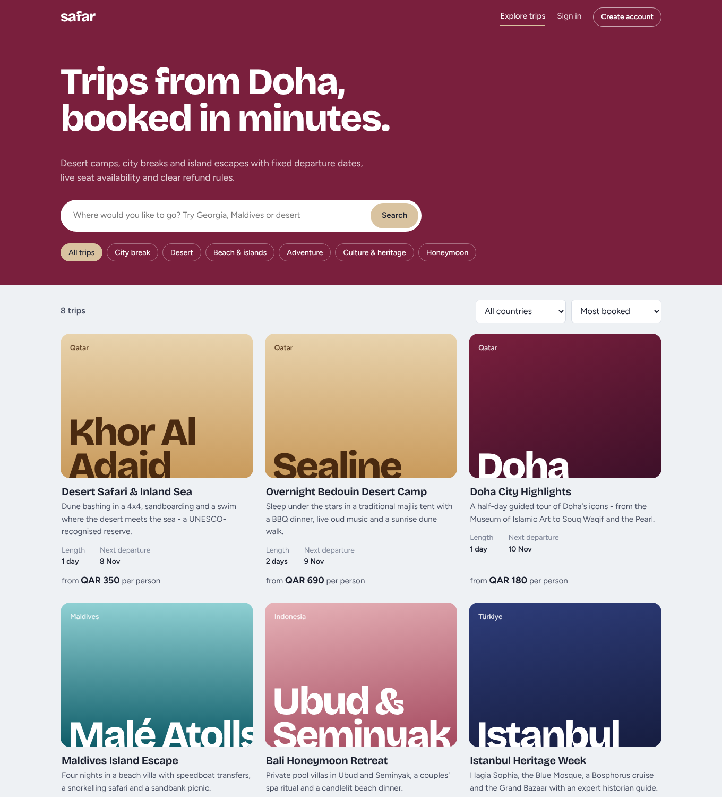
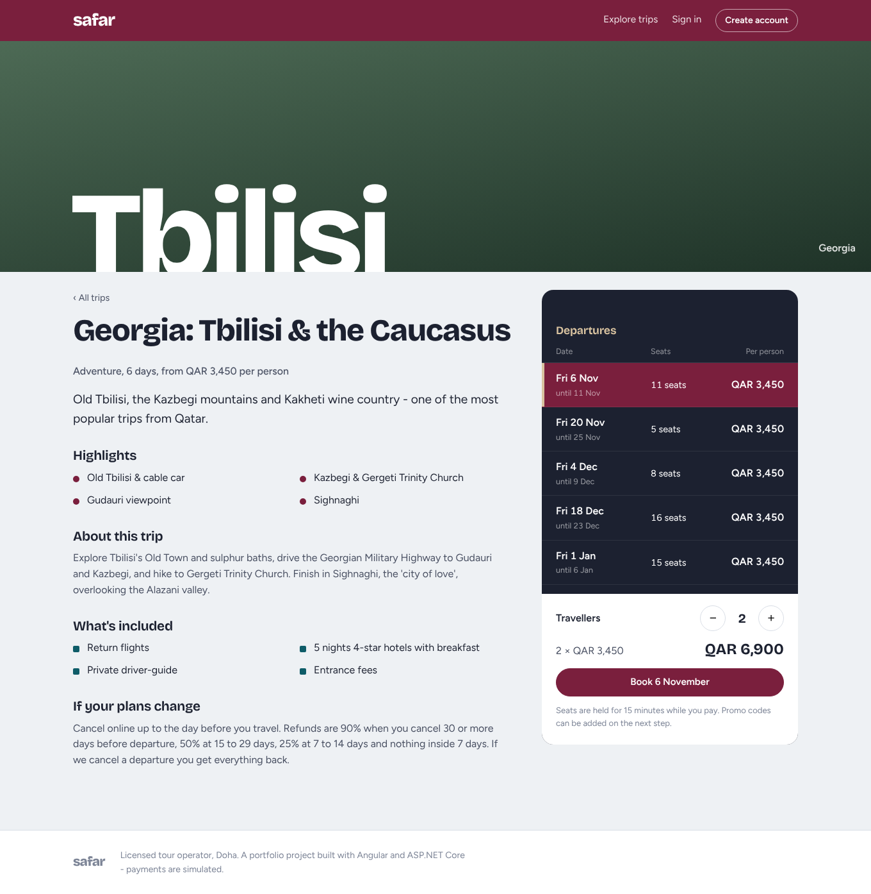
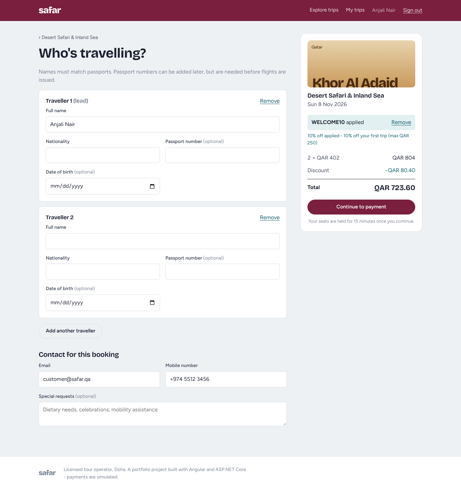
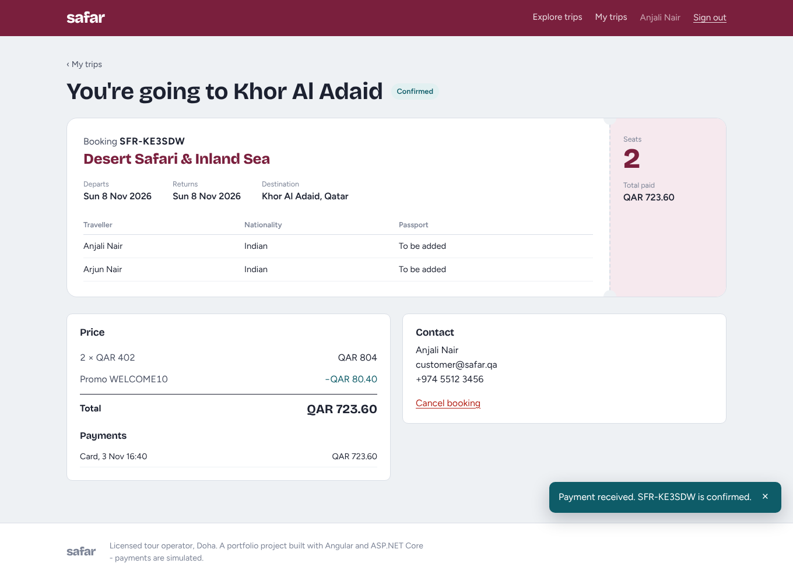
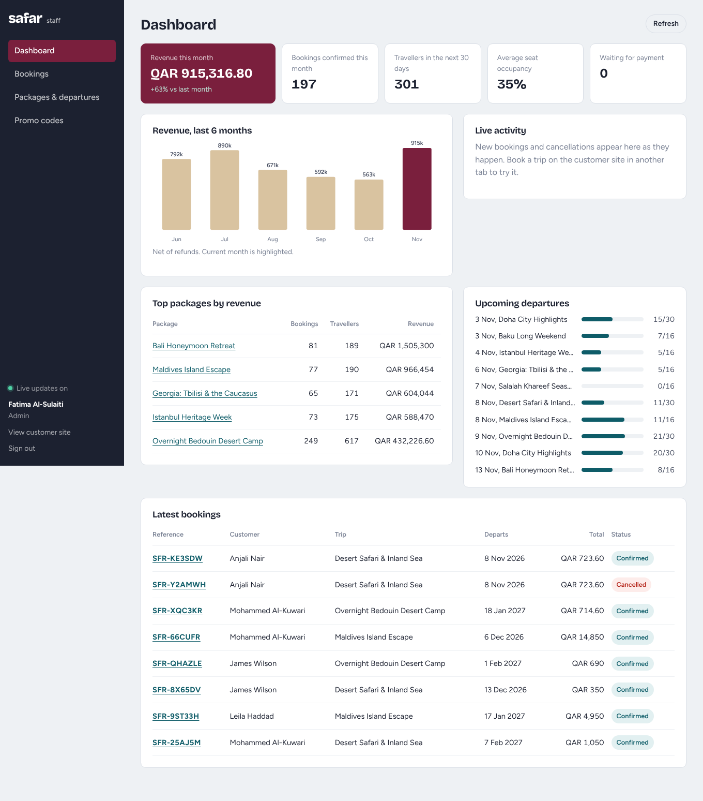
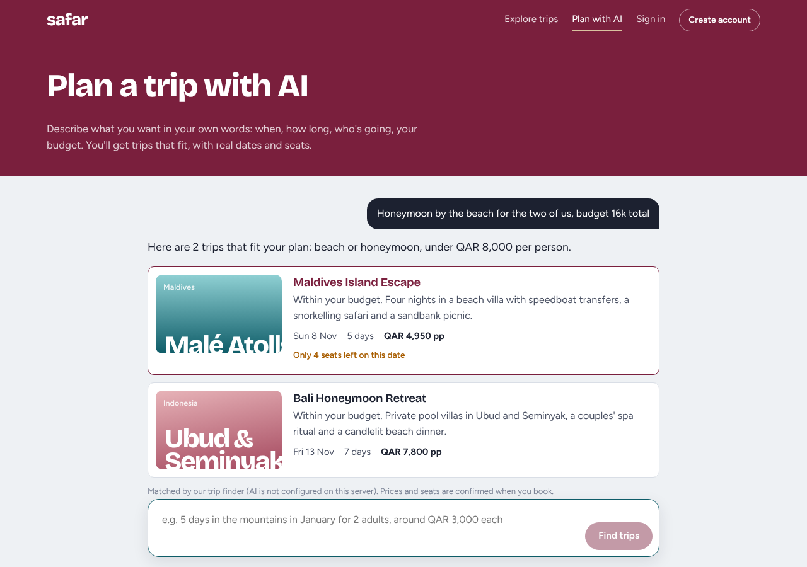
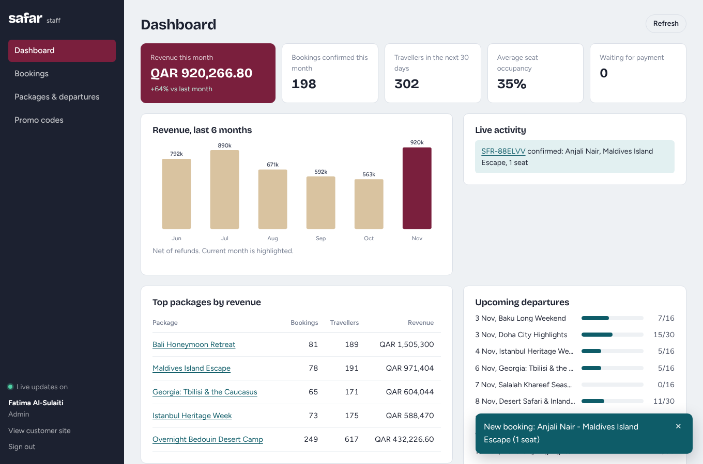
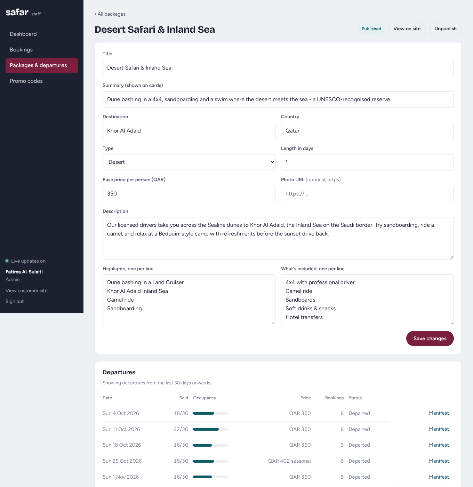

# Safar – Tour Booking Platform

A full-stack tour booking platform for a Doha-based travel agency, built with **Angular 22** and **ASP.NET Core 10** on **PostgreSQL**.

Customers browse tour packages (desert safaris, city breaks, island escapes) or **describe their trip to an AI planner**, pick a dated departure with live seat availability, add travellers, apply a promo code, pay, and cancel online under a clear refund policy. Travel agents manage packages and departures, see bookings arrive in real time, print passenger manifests and track revenue on a dashboard.

It ships with production-style deployment code: **Docker**, **Kubernetes** (Kustomize), **Terraform** for Azure (AKS, ACR, PostgreSQL) and **Ansible** for Ubuntu servers, all exercised by GitHub Actions on every push.

[](https://github.com/1999Anjali1/safar-travel-booking/actions/workflows/ci.yml) [](https://github.com/1999Anjali1/safar-travel-booking/actions/workflows/cd.yml)
        



## Highlights

| | |
|---|---|
| **AI trip planner** | Customers describe a trip in plain words ("honeymoon by the beach, 16k total for two"). A Groq-hosted LLM (OpenAI-compatible API, JSON mode) answers using only the live catalogue in its prompt; every suggestion is then checked against real packages, dates and seats, so the model cannot invent trips. Without an API key, or if the model fails, a rule-based planner answers instead. Rate-limited per IP. |
| **Deployment as code** | Kubernetes manifests (Kustomize overlays, probes, HPA, PDB, NetworkPolicy, migration Job), Terraform for Azure (AKS, ACR, PostgreSQL Flexible Server, Log Analytics), and Ansible roles that harden Ubuntu (SSH, UFW, fail2ban, unattended upgrades) and deploy with Docker Compose. CI deploys to a real Kubernetes cluster and a real Ubuntu machine on every push. |
| **Clean Architecture** | Domain → Application → Infrastructure → API. Business rules live in plain C# entities and are unit tested without a database. |
| **No overselling** | Seat counts use optimistic concurrency on PostgreSQL's `xmin` row version, with automatic retry. An integration test fires 8 simultaneous bookings at a 3-seat departure: exactly 3 succeed. |
| **Seat hold & expiry** | A booking holds seats for 15 minutes while the customer pays. A background service releases unpaid holds every minute. |
| **Refund policy** | 90 % refund 30+ days out, 50 % at 15–29, 25 % at 7–14, none inside 7 days. Operator-cancelled departures refund everyone in full. |
| **Secure auth** | 15-minute JWT access tokens + 7-day refresh tokens. Refresh tokens are stored hashed (SHA-256) and rotated on every use; a reused token is rejected. The Angular interceptor refreshes silently and retries. |
| **Real-time staff portal** | SignalR pushes new bookings and cancellations to every open admin dashboard. |
| **Production touches** | FluentValidation, RFC 7807 ProblemDetails errors, rate-limited auth endpoints, output caching, health checks, EF Core migrations, JSONB and `text[]` columns, passport numbers masked in API responses. |
| **Tested** | 50 unit tests + 21 integration tests against a real PostgreSQL (Testcontainers) + Angular unit tests, all in GitHub Actions CI. |

## Screenshots

| Choose a departure | Traveller details & promo code |
|---|---|
|  |  |

| Booking confirmed | Staff dashboard |
|---|---|
|  |  |

| AI trip planner | Live booking notifications (SignalR) |
|---|---|
|  |  |

| Package & departure management | |
|---|---|
|  | |

## Tech stack

**Backend** – ASP.NET Core 10 Web API · Entity Framework Core 10 + Npgsql (PostgreSQL) · FluentValidation · JWT Bearer + refresh tokens · ASP.NET Core Identity password hashing · SignalR · Hosted background service · Rate limiting · Output caching · Health checks · Swagger

**Frontend** – Angular 22 standalone components · Signals · Reactive Forms (dynamic `FormArray` for travellers) · Functional interceptors & guards · Lazy-loaded routes · Route-bound inputs (`withComponentInputBinding`) · `@microsoft/signalr` · SCSS design system, self-hosted fonts · Vitest

**AI** – Groq LLM (`openai/gpt-oss-20b`) through an OpenAI-compatible typed `HttpClient` · JSON-mode structured output · catalogue grounding and output validation · prompt-injection guard rails · rule-based fallback

**Testing & DevOps** – xUnit · `WebApplicationFactory` · Testcontainers (PostgreSQL) · Docker multi-stage builds · docker-compose · nginx (SPA + API + WebSocket proxy) · Kubernetes + Kustomize · kind · Terraform (azurerm) · Ansible · GitHub Actions (CI, CD, OIDC to Azure) · GitHub Container Registry · Linux (Ubuntu, systemd, UFW, fail2ban)

## Architecture

```
backend/
├── src/
│   ├── Safar.Domain/           Entities and business rules - no dependencies
│   │   ├── Entities/           TourPackage, Departure, Booking, PromoCode, User, RefreshToken
│   │   └── Rules/              PriceCalculator, CancellationPolicy, BookingReference
│   ├── Safar.Application/      Use cases (services), DTOs, validators, interfaces
│   │   ├── Auth/  Packages/  Bookings/  Admin/
│   │   └── Common/             IAppDbContext, ITokenService, IPaymentGateway, INotificationService…
│   ├── Safar.Infrastructure/   Implementations of those interfaces
│   │   ├── Persistence/        AppDbContext, entity configurations, migrations, demo-data seeder
│   │   ├── Auth/               JWT + refresh token service, password hashing
│   │   ├── Payments/           MockPaymentGateway (swap for a real provider)
│   │   └── BackgroundJobs/     ExpireUnpaidBookingsJob
│   └── Safar.Api/              Controllers, SignalR hub, exception handling, Program.cs
└── tests/
    ├── Safar.UnitTests/        Domain rules and validators
    └── Safar.IntegrationTests/ Full HTTP tests against real PostgreSQL

deploy/
├── k8s/           Kustomize base + overlays: local (kind, in-cluster PostgreSQL) and azure (AKS, ACR, ingress + TLS)
├── terraform/     Azure: resource group, AKS, Container Registry, PostgreSQL Flexible Server, Log Analytics
└── ansible/       Ubuntu server: base packages, SSH hardening, UFW, fail2ban, Docker, app deployment

frontend/src/app/
├── core/          models, AuthService (signals), interceptor with token refresh, guards, API clients, SignalR service
├── shared/        QAR pipe, status chip, generated destination covers
├── layout/        customer site shell, staff portal shell
└── features/
    ├── catalog/   explore & search, package page with departure board
    ├── assistant/ AI trip planner
    ├── booking/   checkout, payment & booking page
    ├── account/   my trips
    ├── auth/      sign in, register
    └── admin/     dashboard, bookings, packages & departures, manifest, promo codes
```

Dependencies point inwards: the API references Infrastructure and Application; Application only knows the Domain and its own interfaces. Swapping the mock payment gateway or the database touches one project.

### How a booking works

```
POST /api/bookings
  BookingService.CreateAsync
    → load Departure (with xmin version) + PromoCode
    → Booking.Create(...)          domain: check cut-off, reserve seats, price, redeem promo
    → SaveChanges                  UPDATE departures ... WHERE xmin = @version
        └─ conflict? reload and retry (max 3)
  ← 201 PendingPayment, expires in 15 min

POST /api/bookings/{ref}/pay
    → IPaymentGateway.ChargeAsync
    → booking.Confirm(payment)
    → INotificationService → SignalR → staff dashboards update live

ExpireUnpaidBookingsJob (every minute)
    → PendingPayment past ExpiresAt → Expired, seats released
```

## Run it

### Option 1 – Docker (everything in one command)

```bash
docker compose up --build
```

Open **http://localhost:8080**. PostgreSQL, the API and the Angular app start together; the database is migrated and filled with demo data automatically.

### Option 2 – Local development

Prerequisites: [.NET 10 SDK](https://dotnet.microsoft.com/download), [Node.js 22](https://nodejs.org), PostgreSQL 15+ (or just `docker compose up db`).

```bash
# 1. Database (skip if you have PostgreSQL running with the credentials in appsettings.json)
docker compose up -d db

# 2. API - http://localhost:5080, Swagger at /swagger
cd backend/src/Safar.Api
dotnet run

# 3. Angular - http://localhost:4200
cd frontend
npm install
npm start
```

### Demo accounts

Password for all: `Password@123`

| Role | Email | Can |
|---|---|---|
| Customer | customer@safar.qa | Book, pay, cancel, see own trips |
| Travel agent | agent@safar.qa | Staff portal: dashboard, bookings, packages, departures, manifests |
| Admin | admin@safar.qa | Everything above + cancel departures, manage promo codes |

Promo codes to try: `WELCOME10` (10 %, max QAR 250), `NATIONALDAY` (15 %).

**Turn on the AI planner:** create a free key at [console.groq.com](https://console.groq.com) and set `Ai__ApiKey` (or `GROQ_API_KEY` for docker compose). Without it the planner still works using the built-in rule-based matcher; the page says which one answered.

**Try the real-time feature:** open the staff dashboard as the agent in one window, book and pay as the customer in another – the booking appears on the dashboard immediately.

## Tests

```bash
cd backend
dotnet test tests/Safar.UnitTests          # no dependencies
dotnet test tests/Safar.IntegrationTests   # needs Docker (Testcontainers starts PostgreSQL)

# or point integration tests at an existing PostgreSQL instead of Docker:
SAFAR_TEST_POSTGRES="Host=localhost;Username=safar;Password=safar_dev_password;Database=postgres" dotnet test tests/Safar.IntegrationTests

cd ../frontend
npx ng test --watch=false
```

Integration tests cover: catalogue search and visibility, registration, refresh-token rotation, role-based access, the full quote → book → pay → cancel flow, **concurrent overbooking protection**, payment-hold expiry, customers not seeing each other's bookings, operator cancellation refunds, validation errors and the dashboard.

## API overview

| Method | Endpoint | Auth |
|---|---|---|
| GET | `/api/packages?search=&category=&country=&maxPrice=&sort=&page=` | – |
| GET | `/api/packages/filters` | – |
| GET | `/api/packages/{slug}` | – |
| POST | `/api/auth/register` · `/login` · `/refresh` · `/logout` | – |
| GET | `/api/auth/me` | User |
| POST | `/api/assistant/plan` | – (rate limited) |
| POST | `/api/bookings/quote` | – |
| POST | `/api/bookings` | Customer |
| GET | `/api/bookings/mine` · `/api/bookings/{reference}` | Owner / staff |
| POST | `/api/bookings/{reference}/pay` | Owner |
| GET | `/api/bookings/{reference}/cancellation-quote` | Owner / staff |
| POST | `/api/bookings/{reference}/cancel` | Owner / staff |
| GET | `/api/admin/dashboard` | Agent, Admin |
| GET/POST/PUT | `/api/admin/packages` · `/{id}` · `/{id}/publish` · `/{id}/departures` | Agent, Admin |
| POST | `/api/admin/departures/{id}/cancel` | Admin |
| GET | `/api/admin/departures/{id}/manifest` | Agent, Admin |
| GET | `/api/admin/bookings?status=&search=` | Agent, Admin |
| GET/POST | `/api/admin/promo-codes` | Agent (read), Admin |
| WS | `/hubs/notifications` | Agent, Admin |
| GET | `/health` (readiness: DB + migrations) · `/health/live` | – |

Errors use RFC 7807 ProblemDetails: `400` validation (with field errors), `401`, `403`, `404`, `409` conflict, `422` business rule (e.g. "Only 2 seat(s) left on this departure."), `429` rate limited.

## Deployment

Three ways to run Safar in production, all in [`deploy/`](deploy) and all exercised by the [CD workflow](.github/workflows/cd.yml):

| Target | How | Tested in CI by |
|---|---|---|
| Single Linux server | `ansible-playbook -i inventory/hosts.yml site.yml` – installs packages, sets the timezone, hardens SSH, enables UFW (22/80/443) and fail2ban, installs Docker, writes the Compose file and secrets, starts the stack and waits until it answers | Running the playbook against a fresh Ubuntu 24.04 runner, then **running it again and failing if anything changed** (idempotency), then curling the site |
| Kubernetes (any) | `kubectl apply -k deploy/k8s/overlays/local` – API (2 replicas, liveness/readiness/startup probes, non-root, read-only filesystem), web, HPA, PodDisruptionBudget, NetworkPolicy, and a migration Job that runs `--migrate` once | Building the images, creating a **kind** cluster, deploying, waiting for the migration Job and rollouts, smoke-testing nginx → API → PostgreSQL (including the AI planner), then a rolling restart under traffic |
| Azure | `terraform apply` in `deploy/terraform` creates AKS, ACR (AcrPull for the cluster), PostgreSQL Flexible Server and Log Analytics; the manual **Deploy to AKS** job builds images in ACR, creates secrets and applies the `azure` overlay with OIDC login | `terraform fmt -check`, `terraform validate`, `kubeconform` against the Kubernetes 1.31 schema. Applying to Azure needs a subscription, so it runs only when triggered by hand |

```
push to main
  ├─ CI: .NET unit + integration tests · Angular tests & build · docker compose build
  └─ CD: terraform validate · kubeconform · ansible-lint
         ├─ kind cluster: deploy → migrate Job → rollout → smoke test → rolling restart
         ├─ Ubuntu runner: Ansible provision → smoke test → idempotency check
         └─ publish images to ghcr.io  ──(manual)──▶ build in ACR → deploy to AKS
```

### Run on your own Kubernetes

```bash
docker build -t safar-api:local backend && docker build -t safar-web:local frontend
kind create cluster --name safar
kind load docker-image safar-api:local safar-web:local --name safar
kubectl apply -k deploy/k8s/overlays/local
kubectl -n safar port-forward svc/web 8080:80     # http://localhost:8080
```

### Provision a server with Ansible

```bash
cd deploy/ansible
cp inventory/hosts.example.yml inventory/hosts.yml   # your server's IP and user
ansible-vault create group_vars/web/vault.yml         # vault_safar_postgres_password, vault_safar_jwt_key, vault_safar_ai_api_key
ansible-playbook site.yml --ask-vault-pass
```

## Design decisions

- **Rich domain model** – `Departure.ReserveSeats`, `Booking.Confirm`, `Booking.Cancel` enforce the rules themselves, so they can't be bypassed by a new endpoint and are tested in isolation.
- **Optimistic, not pessimistic, locking** – no row locks held while users fill in forms; conflicts are rare and retried.
- **Travellers as JSONB** – they are always read with their booking, never queried alone, so one row beats a join table.
- **Money as `numeric(12,2)`** and enums stored as readable text in the database.
- **Payment is an interface** – `MockPaymentGateway` stands in for QPay / Stripe / Checkout.com. No card data ever touches the API.
- **AI output is untrusted** – the model only sees the catalogue, is told the customer's text is data, and its answer is parsed as JSON and checked slug by slug and date by date before it reaches the browser. Wrong or invented items are dropped, never shown.
- **Migrations run once, not per pod** – Kubernetes runs `--migrate` as a Job; API pods report ready only when `/health` sees no pending migrations, so traffic never reaches a half-migrated database.
- **Covers without stock photos** – package artwork is generated from the destination name and trip type, so the catalogue never shows broken or unlicensed images. Real photos can be added per package.

## Possible next steps
- Email confirmations (background queue) and PDF e-tickets
- Real payment provider with webhooks
- Arabic language and RTL layout
- Wishlist and reviews
- GitOps with Argo CD, and Prometheus/Grafana dashboards
- Private networking for PostgreSQL (VNet integration) and Azure Key Vault for secrets
